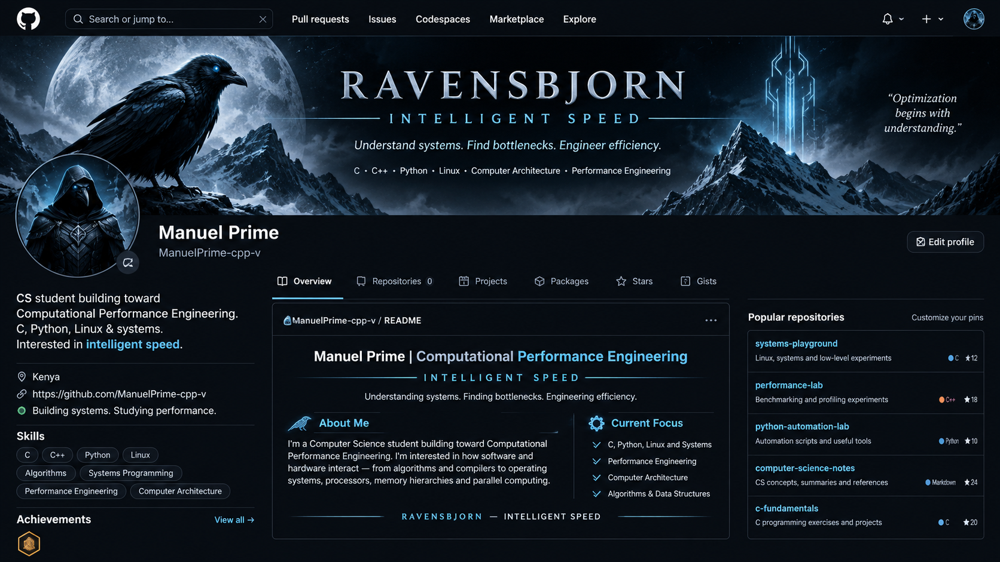

# ⚔️ RAVENSBJORN — DASH
### INTELLIGENT SPEED · PERSONAL COMMAND CENTER

<p align="center">
  
</p>

<p align="center">
  <strong>A personal command center for learning, building, thinking, and engineering.</strong>
</p>

<p align="center">
  
  
  
</p>

<p align="center">
  <em>Observe. Understand. Build. Measure. Improve.</em>
</p>

---

# 01 — THE IDEA

> "The objective is not merely to make things faster. It is to understand where resources are wasted, why inefficiencies exist, and how to engineer better outcomes."

**RAVENSBJORN DASH** is envisioned as my personal digital command center: a central environment for organizing my technical journey, academic development, projects, experiments, research, goals, and personal progress.

It represents more than a dashboard.

It is an evolving record of a journey from learning the fundamentals of computer science to becoming a capable Computational Performance Engineer.

The idea is simple:

Build a system that helps me remain organized, intentional, informed, and consistent while developing the knowledge and practical skills needed to work at the intersection of software, hardware, and computational efficiency.

Rather than scattering important information across disconnected applications, notes, documents, and tools, DASH aims to bring the most relevant parts of my working life into one coherent environment.

**One environment. Multiple disciplines. One direction.**

---

# 02 — THE IDENTITY

## RAVENSBJORN

RAVENSBJORN is my personal technical identity.

The raven represents observation, intelligence, adaptability, patience, and strategic thinking. It is a symbol of the mindset I want to bring into engineering: understand before acting, observe before concluding, and think beyond the obvious.

The visual identity draws inspiration from Nordic and Viking aesthetics, interpreted through a modern technological lens.

## INTELLIGENT SPEED

This is the philosophy behind the identity.

Performance is not achieved by blindly adding more resources, writing more code, or choosing the newest technology.

It comes from understanding a system, measuring its behaviour, identifying inefficiencies, and applying the right improvements.

I want this philosophy to extend beyond programming into the way I study, plan, build, research, and manage my time.

## The three pillars

| Pillar | Meaning |
|---|---|
| RAVENSBJORN | The identity |
| INTELLIGENT SPEED | The philosophy |
| Computational Performance Engineering | The technical destination |

---

# 03 — THE PERSON BEHIND THE PROJECT

I am a Computer Science student in Kenya, currently pursuing a Diploma in Computer Science at Kabarak University.

I am building toward a career in **Computational Performance Engineering (CPE)**.

My interests lie in understanding how computation works beneath the surface: how algorithms operate, how programming languages interact with hardware, how compilers generate machine instructions, how operating systems manage resources, and how processors, memory, accelerators, and networks influence performance.

I am particularly interested in the relationship between software and hardware.

I don't want to become someone who merely knows how to use tools. I want to understand the systems behind those tools.

My approach is rooted in:

- First-principles thinking.
- Systems-level understanding.
- Analytical problem-solving.
- Continuous learning.
- Technical independence.
- Evidence-based engineering.
- Practical experimentation.
- Long-term academic and professional development.

DASH is intended to support that development.

It is both a practical instrument and a representation of the person I am working to become.

---

# 04 — THE STORY: HOW I ARRIVED HERE

My technical direction has evolved through several connected interests.

### The HFT fascination

My earlier interest was High-Frequency Trading.

I was attracted to the engineering challenges behind quantitative and low-latency financial systems.

The combination of mathematics, algorithms, networking, software performance, and computer architecture was particularly interesting.

Firms such as Jane Street and Citadel Securities represented environments where computational efficiency could have significant consequences.

The question that fascinated me was:

**How do you build a system that can process information and respond with extremely low latency?**

### The FPGA exploration

That curiosity took me closer to the hardware.

I became interested in Field-Programmable Gate Arrays, digital logic, Verilog, SystemVerilog, and hardware acceleration.

I wanted to understand how computation could be implemented directly in configurable hardware rather than relying exclusively on conventional software execution.

This introduced another important question:

**What if we could change the hardware itself to execute a task more efficiently?**

### The broader realization

Eventually, I recognized that HFT was an application domain and FPGA was one possible engineering technology.

The underlying interest connecting both was computational performance.

Performance problems do not exist only in trading systems or hardware circuits.

They can emerge at every level of a computing system.

An inefficient algorithm, poor memory access pattern, compiler decision, operating-system overhead, processor bottleneck, network limitation, or thermal constraint can all influence the final result.

This led me toward Computational Performance Engineering.

DASH is designed to accompany this journey: from the fundamentals to increasingly sophisticated engineering work.

---

# 05 — THE NORTH STAR: COMPUTATIONAL PERFORMANCE ENGINEERING

Computational Performance Engineering is the systematic investigation, measurement, analysis, and improvement of computational efficiency.

The goal is to understand how computational systems behave and how they can perform their work more effectively.

My long-term technical interests include:

| Domain | Areas of interest |
|---|---|
| Algorithms | Complexity, optimization, data structures |
| Systems programming | C, C++, memory management |
| Compilers | Code generation, optimization, runtimes |
| Operating systems | Processes, scheduling, resource management |
| Computer architecture | CPUs, instruction execution, pipelines |
| Memory systems | Cache hierarchies, bandwidth, data locality |
| Parallel computing | Concurrency, synchronization, scalability |
| Accelerators | GPUs, specialized processors, FPGA |
| Interconnects | PCIe, networking, data movement |
| Performance analysis | Profiling, benchmarking, bottleneck analysis |
| Energy efficiency | Power consumption, thermals, resource utilization |

The central question is:

**How can a computational system accomplish more useful work with less wasted time, energy, memory, and complexity?**

Potential application areas include:

- High-performance computing.
- Low-latency financial systems.
- AI infrastructure and accelerated computing.
- Scientific computation and simulation.
- Compiler and runtime engineering.
- Computer architecture.
- Hardware-software co-design.

These are areas I intend to explore and develop toward, not claims of existing professional specialization.

---

# 06 — THE EDUCATION ROADMAP

My academic ambitions are long-term, deliberate, and technically oriented.

```text
KENYA
  |
  v
KABARAK UNIVERSITY
Diploma in Computer Science
  |
  v
STRATHMORE UNIVERSITY
BSc Informatics and Computer Science
  |
  v
EUROPE
Postgraduate specialization
  |
  v
SWITZERLAND
Preferred destination
  |
  v
ETH ZURICH
Long-term academic ambition
```

### Stage I — Kabarak University

**Current stage: Diploma in Computer Science**

The priority is to establish a strong foundation.

I want to develop:
- Programming fundamentals.
- Mathematical reasoning.
- Algorithms and data structures.
- Problem-solving ability.
- Computer systems knowledge.
- Consistent study habits.
- Practical programming competence.

The diploma is the beginning of the journey, not its final destination.

### Stage II — Strathmore University

**Planned progression: BSc in Informatics and Computer Science**

The bachelor's degree is intended to deepen my understanding of computer science and provide the academic foundation for specialization.

Areas of particular importance include:
- Advanced programming.
- Algorithms and data structures.
- Operating systems.
- Computer architecture.
- Networks.
- Compilers.
- Parallel and concurrent computing.
- Software engineering.
- Mathematics and computational methods.

### Stage III — Europe

**Preferred postgraduate destination: Switzerland.**

ETH Zurich is my principal ambition.

I want to pursue a postgraduate specialization that aligns with computational performance, systems, architecture, or advanced computing.

The objective is to arrive at that stage with strong academic preparation, genuine engineering projects, research experience where possible, and a clearly developed technical direction.

This is an ambition that will require academic excellence, preparation, research, and financial planning.

---

# 07 — THE TECHNICAL DEVELOPMENT ROADMAP

The technical journey is deliberately progressive.

## FOUNDATION — BUILD THE FUNDAMENTALS

**Current priorities**

| Technology / Discipline | Objective |
|---|---|
| C | Understand programming closer to the machine |
| Python | Develop automation and practical software skills |
| Linux | Strengthen command-line and systems knowledge |
| Mathematics | Develop analytical and computational reasoning |
| Algorithms | Understand problem-solving efficiency |
| Git | Maintain a disciplined development history |

### C programming

C is one of my most important foundations.

I want to understand:
- Data representation.
- Variables and types.
- Functions.
- Arrays and strings.
- Pointers.
- Structures.
- Memory allocation.
- Stack and heap.
- File handling.
- Compilation and linking.
- Debugging.

### Python development

Python is an immediate practical priority.

My intended areas include:
- Automation.
- File processing.
- CSV and JSON.
- Excel and PDF workflows.
- APIs.
- SQLite.
- Data processing.
- Scripting.
- Small freelance projects.

Python will also be useful for research, experimentation, and quantitative computing.

### Linux

My current operating system is CachyOS KDE Plasma, based on Arch Linux.

I want to become increasingly comfortable with the command line and terminal-first development.

Tools of interest include:
- Neovim.
- Zsh.
- tmux.
- Git.
- GCC.
- Clang.
- GDB.
- LLDB.
- CMake.
- Ninja.
- ripgrep.
- fzf.

## SYSTEMS — UNDERSTAND THE MACHINE

**Next learning priorities**

- C++.
- Memory hierarchy.
- Operating systems.
- Computer architecture.
- Concurrency.
- Compilers.
- Debugging.
- Data structures.
- Computer networks.

## PERFORMANCE — MEASURE AND OPTIMIZE

**Longer-term development**

- Profiling.
- Benchmarking.
- Cache optimization.
- Algorithmic optimization.
- Parallel computing.
- CPU performance analysis.
- Memory performance.
- GPU computing.
- Hardware acceleration.

## SPECIALIZATION — EXPLORE THE FRONTIER

**Future exploration**

- FPGA engineering.
- Verilog and SystemVerilog.
- GPU architecture.
- High-performance computing.
- Compiler engineering.
- Low-latency systems.
- Hardware-software co-design.
- Energy-efficient computing.

The roadmap should evolve as my knowledge and interests develop.

---

# 08 — WHY DASH EXISTS

DASH is intended to solve a practical problem.

A demanding technical journey involves many simultaneous responsibilities:

- University coursework.
- Independent study.
- Programming practice.
- Technical reading.
- Personal projects.
- Research and experimentation.
- Freelancing.
- Long-term career planning.
- Personal development.

Without a coherent system, it becomes easy to lose track of priorities, forget progress, duplicate effort, or spend time organizing rather than doing the actual work.

DASH is intended to provide a central place to manage these activities.

It should help answer questions such as:

- What am I currently working on?
- What should I prioritize?
- Which projects are active?
- What have I learned?
- What remains unfinished?
- Which experiments have I conducted?
- What progress have I made?
- Where am I heading next?

The philosophy is to reduce organizational friction so more attention can be directed toward meaningful work.

---

# 09 — DASH: THE VISION

DASH is envisioned as a modular personal command center.

Its intended areas of responsibility include the following.

### 01. Overview

A high-level view of my current position.

Potential information:
- Current priorities.
- Active projects.
- Study progress.
- Upcoming deadlines.
- Recent activity.
- Important goals.

### 02. Academic Command

A dedicated environment for university work.

Intended capabilities:
- Course organization.
- Lecture tracking.
- Study schedules.
- Assignment tracking.
- Examination preparation.
- Revision records.
- Academic performance tracking.

### 03. Learning Laboratory

A place to organize independent learning.

Intended capabilities:
- Learning paths.
- Topics under study.
- Technical reading lists.
- Learning progress.
- Knowledge notes.
- Concepts requiring further investigation.

### 04. Project Command

A central view of software and engineering projects.

Intended capabilities:
- Project inventory.
- Project status.
- Development milestones.
- Technologies used.
- Repository links.
- Project documentation.
- Future improvements.

### 05. Performance Laboratory

A future home for computational experiments.

Intended capabilities:
- Benchmark records.
- Profiling investigations.
- Algorithm comparisons.
- Memory experiments.
- Compiler experiments.
- Performance observations.
- Reproducible experiment notes.

### 06. Research and Intelligence

A place to organize technical research and discoveries.

Potential areas:
- Computer architecture.
- Semiconductor technology.
- GPU computing.
- Systems engineering.
- AI infrastructure.
- Quantitative computing.
- Scientific computing.

### 07. Career and Mission Planning

A structured view of the longer journey.

Potential information:
- Academic milestones.
- Technical competency goals.
- Portfolio development.
- Internship preparation.
- Freelancing objectives.
- Postgraduate planning.

### 08. Personal Operations

The system should also support the human being doing the engineering.

Potential areas:
- Daily planning.
- Habits.
- Reading.
- Physical training.
- Reflection.
- Time management.
- Personal goals.

These modules describe the intended vision. They should only be represented as completed functionality when the actual application implements them.

---

# 10 — THE FREELANCING OBJECTIVE

An important part of my journey is developing practical skills that can generate income before postgraduate education.

My immediate technical priority is Python.

The intended progression is:

**FOUNDATIONS → AUTOMATION → CLIENT PROJECTS → INDEPENDENT DEVELOPMENT**

Potential services include:
- File and document automation.
- Spreadsheet processing.
- CSV and JSON transformation.
- Data cleaning.
- PDF processing.
- API integrations.
- Small scripting tools.
- Basic database workflows.

My working target has been to develop these skills through December 2026 and begin pursuing small freelance opportunities in early 2027.

The broader objective is to gain practical experience, improve engineering discipline, build a portfolio, and contribute toward the financial demands of my academic journey.

DASH should eventually help me monitor these objectives without becoming a distraction from the actual work.

---

### Design principles

1. Visual clarity over decoration.
2. Consistency over unnecessary novelty.
3. Useful information over empty visual elements.
4. Subtle animation only where meaningful.
5. Strong readability on desktop and mobile.
6. A coherent visual hierarchy.
7. Minimalist Nordic influence.

The goal is not to make the interface look aggressive.

It should feel intelligent, precise, calm, and capable.

---

# 12 — ENGINEERING PRINCIPLES

DASH should reflect the same discipline I want to develop as an engineer.

### Understand before optimizing

Do not assume a system has a performance problem without investigating it.

### Measure before making claims

Whenever performance is discussed, prefer reproducible measurements over subjective impressions.

### Build progressively

Avoid introducing unnecessary complexity before the fundamentals are established.

### Prefer maintainability

Code should be readable, structured, and documented.

### Respect resource constraints

Memory, processing time, storage, energy, and network resources all matter.

### Document the reasoning

A good engineering result should explain not only what changed, but why the change was necessary.

### Build for evolution

The project should be modular enough to grow as my needs become more sophisticated.

---

# 13 — PROJECT STATUS AND DEVELOPMENT PHILOSOPHY

DASH is intended to evolve alongside my academic and technical journey.

The roadmap below describes the intended direction, not a claim that all these capabilities are currently implemented.

| Phase | Direction |
|---|---|
| Foundation | Establish the core dashboard and navigation |
| Organization | Introduce academic, learning, and project management |
| Intelligence | Improve tracking, summaries, and useful insights |
| Engineering | Add technical experiment and research workflows |
| Integration | Connect relevant development and productivity tools |
| Refinement | Improve reliability, usability, performance, and maintainability |

The most important principle is to build useful functionality before adding complexity.

A feature should exist because it solves a real problem.

---

# 14 — REPOSITORY STRUCTURE

The repository should maintain a clear, understandable structure.

An illustrative organization could look like this:

```text
DASH/
│
├── README.md
├── LICENSE
├── .gitignore
├── package.json
│
├── public/
│   ├── assets/
│   ├── images/
│   └── icons/
│
├── src/
│   ├── components/
│   ├── modules/
│   ├── pages/
│   ├── layouts/
│   ├── styles/
│   ├── hooks/
│   ├── services/
│   └── utils/
│
├── docs/
│   ├── architecture/
│   ├── roadmap/
│   └── decisions/
│
└── tests/
    ├── unit/
    └── integration/
```

---

# 15 — DOCUMENTATION AND CONTRIBUTION

Good documentation is part of good engineering.

As the project matures, documentation should explain:

- What the application does.
- Why it exists.
- How it is structured.
- How to install it.
- How to configure it.
- How to run it.
- How to test it.
- How to contribute.
- What is planned next.

Contributions, suggestions, and constructive technical feedback are welcome where the repository is open to collaboration.

The intention is to maintain a project that can be understood, improved, and extended without unnecessary friction.

---

# 16 — A NOTE ON THE LONG-TERM VISION

I want to build a working environment that supports a lifetime of learning and engineering.

Today, that means organizing university studies, mastering C and Python, developing Linux proficiency, and building small projects.

Tomorrow, it could mean tracking advanced systems research, compiler experiments, performance benchmarks, GPU investigations, or hardware acceleration projects.


---

# 17 — THE FINAL PRINCIPLE

> "Do not optimize what you do not understand. Do not measure what you cannot reproduce. Do not build complexity without purpose."

RAVENSBJORN is a commitment to understanding systems rather than merely interacting with them.

It exists to support the work behind the ambition: the studying, coding, reading, experimenting, measuring, questioning, and improving.

There is a long journey ahead, and this repository is part of documenting it.

<p align="center">
  <strong>RAVENSBJORN</strong>
</p>

<p align="center">
  <strong>INTELLIGENT SPEED</strong>
</p>

<p align="center">
  <em>Observe deeply. Think precisely. Engineer intelligently.</em>
</p>

---

<p align="center">
  <sub>Built with curiosity, discipline, and an obsession with understanding how things work.</sub>
</p>

### `0x03` // FEATURED WORKSPACE & REPOSITORIES

| Repository | Description |
| :--- | :--- |
| **[`intelligent-speed-labs`](https://github.com)** | Practical experiments in C, C++, and Python measuring memory behavior, data structures, and compiler optimizations. |
| **[`nvim-config`](https://github.com)** | Cross-platform, IDE-grade Neovim configuration deployable across Linux and Termux via a universal symlink installer. |

### `0x04` // ACTIVE PROFILING & CURRENT FOCUS

```yaml
system_identity:
  brand: RAVENSBJORN
  philosophy: INTELLIGENT SPEED
  direction: Computational Performance Engineering (CPE)

active_investigations:
  - layer: "Systems & Memory"
    focus: "Low-level C/C++ memory management, cache locality, and profiling"
  - layer: "Hardware & Logic"
    focus: "Digital logic design, Verilog/SystemVerilog, and FPGA acceleration"
  - layer: "Environment & Tooling"
    focus: "Linux internals, Wayland/Niri workflows, and cross-platform Neovim"

current_objective: "Measure. Understand. Optimize."
```

### `0x05` // TELEMETRY & ACTIVITY

<div align="center">
  
  
</div>

<div align="center">
  
</div>
<div align="center">
  
</div>
<div align="center">
  
</div>

### `0x07` // LIVE LAB ACTIVITY

<!--START_SECTION:activity-->
<!--END_SECTION:activity-->
